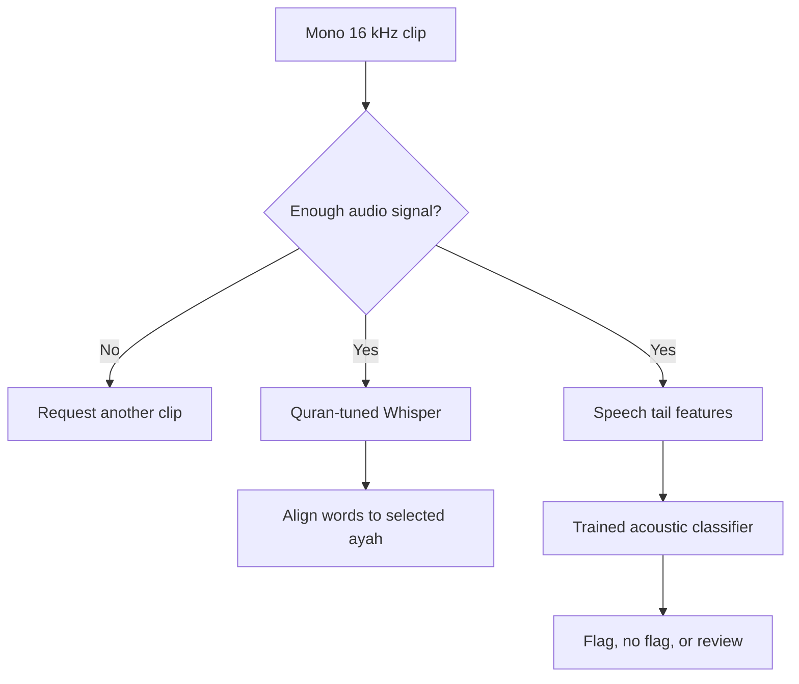

# Ayah Feedback Lab

**Can a speech model recognize every word of an ayah and still miss a pronunciation error?**

Ayah Feedback Lab is a browser-based research prototype for Quran recitation feedback. Record or upload a single ayah to compare two signals side by side: what a Quran-tuned Whisper model transcribed and whether a trained acoustic classifier detected a possible issue with final **د** qalqalah.

The experiment focuses on two verses from Surah Al-Ikhlas: **112:1** (أَحَدٌ) and **112:2** (ٱلصَّمَدُ). After setup, the app runs on CPU without an API key or GPU.

## What the demo shows

| In the app | What you can inspect |
| --- | --- |
| **Wording check** | Missing, substituted, or extra words compared with the selected ayah. |
| **Acoustic check** | A flag, no flag, or review result based on acoustic features near the end of the recitation. |
| **Held-out examples** | A clip where Whisper matched the wording and the acoustic model flagged the target issue, plus a correctly labeled clip that the acoustic model flagged in error. |

> The verifier covers one pronunciation rule on two ayahs. Its output is intended for review with a qualified teacher.

## Results on held-out recordings

The benchmark uses **144 held-out clips from 76 dataset participant IDs**. The split contains 70 clips with the target error and 74 labeled correct. Six configurations were compared on the validation fold. The selected model used a 600 ms speech tail, logistic regularization `C = 0.1`, and review thresholds of 0.45 and 0.60.

| Signal | Target errors flagged | False flags on correct clips | Sent to review |
| --- | ---: | ---: | ---: |
| Whisper final-word change proxy | 31/70 | 10/74 | 0/144 |
| Whisper any-word change proxy | 40/70 | 13/74 | 0/144 |
| Trained acoustic verifier | **38/70** | **13/74** | **13/144** |

The verifier flagged seven more target cases than the final-word proxy and also raised three more false flags. The any-word proxy flagged 40 target cases with the same number of false flags as the verifier, but it can flag unrelated words. These counts measure clip-level flagging against the target label. The two Whisper proxies cannot identify which pronunciation rule was broken.

The acoustic model reached **0.805 AUROC**. The beginning-of-clip control reached **0.647 AUROC**, which suggests some predictive cues exist away from the target sound. False flags also differed by ayah, with **11/38** correct clips flagged on 112:1 versus **2/36** on 112:2.

| Stress condition | False flags on 74 correct clips | Review on 144 clips |
| --- | ---: | ---: |
| Original audio | 13 | 13 |
| −12 dB gain | 13 | 16 |
| +12 dB SNR white noise | 10 | 49 |
| Last 120 ms of active audio clipped | 19 | 18 |

The model is suitable for demonstrating the experiment and inspecting errors. Its false flags and sensitivity to clipped audio make it unsuitable for automatic learner correction.

[Full metrics, validation runs, stress tests and example cases](evaluation.json)

## Run locally

Use Python 3.12. From the project directory on Windows PowerShell:

```powershell
py -3.12 -m venv .venv
.\.venv\Scripts\python.exe -m pip install -r requirements.txt
.\.venv\Scripts\python.exe app.py --warmup
.\.venv\Scripts\python.exe prepare_samples.py --held-out
.\.venv\Scripts\python.exe app.py
```

On macOS or Linux, create the environment with `python3.12 -m venv .venv` and use `.venv/bin/python` in place of the Windows interpreter path. After the server starts, open the address printed in your terminal in Chrome or Edge. Internet is needed for the first dependency, checkpoint and example downloads. No API key or GPU is required. Microphone and upload inputs accept one ayah per clip.

### What to try

1. **Start with a case where the models disagree.** Select the ayah printed by `prepare_samples.py --held-out` and upload the file beginning with `whisper_wording_match_acoustic_flag`. Compare the wording match with the acoustic flag and the expert label in the evaluation report.
2. **Inspect a false flag.** Upload the file beginning with `acoustic_false_flag` using its printed ayah. This clip is labeled correct and shows why the acoustic score needs review.
3. **Try the wording checks.** Under **Try without audio**, compare a correct transcript and a skipped-word transcript. **Run checks** exercises alignment and retry cases. These fixtures are separate from the audio benchmark.

For a standard recitation, synthetic word omission and silence, run `python prepare_samples.py` without flags. If audio setup is unavailable, `python app.py` runs the transcript path with the Python standard library.

## How the experiment works



- **Wording baseline.** Whisper decodes without the reference ayah as a prompt. Arabic normalization removes diacritics and folds selected script variants. Word-level Levenshtein alignment finds missing, substituted, and extra words. The pronunciation benchmark uses final-word deletion or substitution as the baseline proxy. A wording flag alone cannot diagnose qalqalah.
- **Acoustic verifier.** Trim quiet boundaries using frame energy, summarize MFCCs, relative energy and zero-crossing rate across three portions of the speech tail, and train standardized logistic regression. Validation compares 360 ms and 600 ms crops with three regularization strengths. The selected model uses two thresholds to route uncertain examples to review.
- **Data checks.** Use one exact expert error label and clips labeled correct from the same two ayahs. Remove repeated metadata rows and clusters of identical decoded PCM. Group splits by the participant identifiers encoded in filenames. The dataset provides those identifiers, and speaker identity was not independently confirmed.
- **Shortcut control.** Train a separate classifier on the beginning of each clip, where the target ending has not yet occurred. Above-chance performance there is evidence that the dataset carries other predictive cues, such as speaker characteristics, recording conditions, or correlated recitation traits.
- **Stress tests.** Apply gain reduction, added white noise, and a clipped ending to the same held-out clips. These are controlled transformations of existing audio. Their results are kept separate from the original-clip benchmark.

## Reproduce training and evaluation

```text
python -m pip install -r requirements-train.txt
python download_dataset.py
python train_verifier.py dataset-cache --output runs
python stress_verifier.py dataset-cache runs
python app.py --warmup
python compare_baseline.py dataset-cache runs
python -m unittest discover -s tests -v
```

Use the environment interpreter from the setup section for `python`. The downloader pins the dataset revision and fetches only experiment files. Training writes JSON coefficients and thresholds, aggregate metrics, and a per-clip prediction CSV into `runs/`. The checked-in model and metrics let the demo run without downloading the full dataset. The original recordings are downloaded separately for reproduction and demo playback.

`benchmark.py` evaluates wording on a UTF-8 CSV with `audio,ayah,spoken_words` columns. Use the words the speaker actually said, including mistakes. It reports ASR WER separately from edit location/type precision and recall, with reference positions assigned by deterministic alignment.

## Scope and limitations

This is a known-ayah, post-clip experiment. The model score is uncalibrated and can be affected by mic quality, background noise, clipped endings, and differences across reciters. The held-out split comes from one public dataset. A stronger deployment study would use independently collected learner recordings, verify speaker separation, and test other pronunciation errors as explicit negative examples.

## Data and model credits

- Maghraby et al., *Surah Al-Ikhlas of the Holy Qur'an Error Detection Dataset*, Mendeley Data (2024), [DOI 10.17632/sxtmmr6mvk.1](https://doi.org/10.17632/sxtmmr6mvk.1), CC BY 4.0. The experiment uses the [Hugging Face packaging](https://huggingface.co/datasets/MuazAhmad7/Surah_Ikhlas-Labeled_Dataset).
- [Tarteel AI Quran Whisper](https://huggingface.co/tarteel-ai/whisper-base-ar-quran) and [OdyAsh CTranslate2 conversion](https://huggingface.co/OdyAsh/faster-whisper-base-ar-quran).
- [Quran.com Al-Ikhlas reference text](https://quran.com/112) and [EveryAyah Alafasy audio](https://everyayah.com/data/Alafasy_128kbps/112001.mp3) for the optional synthetic controls.
